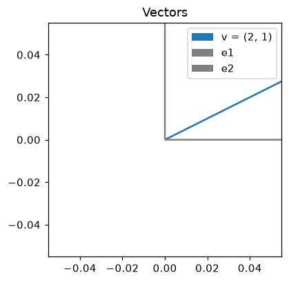
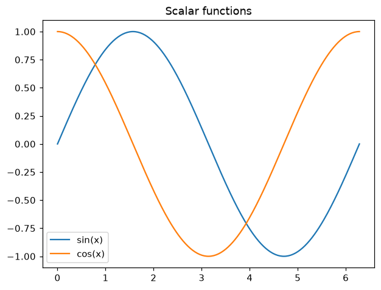
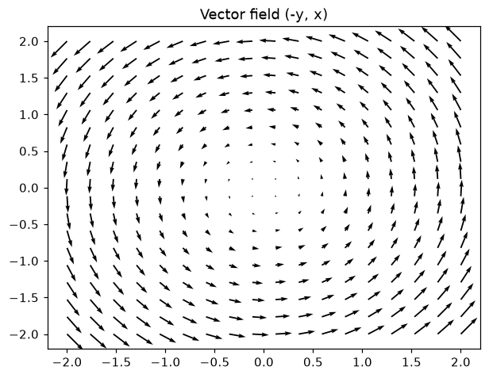
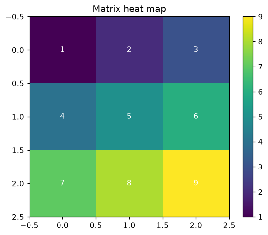
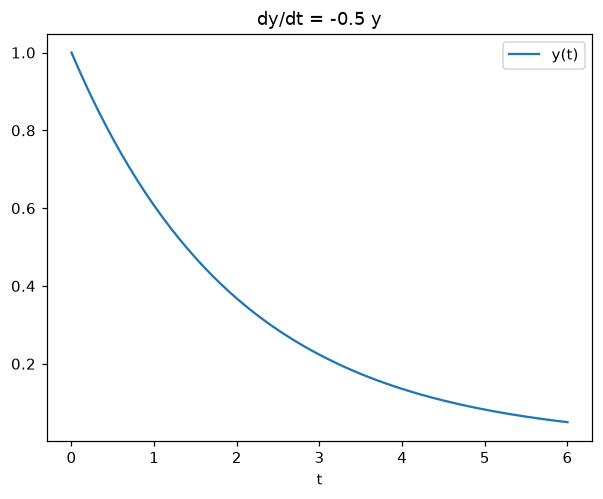
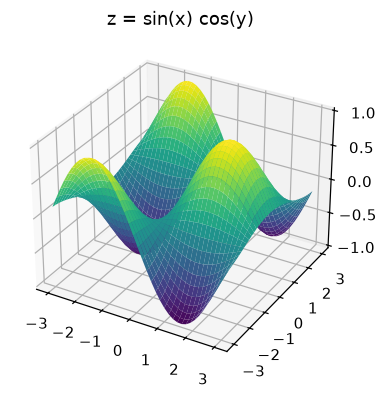
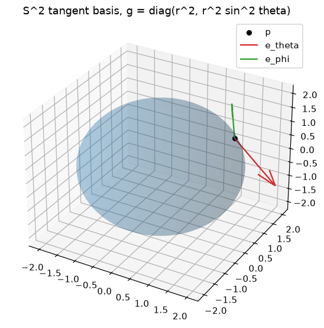

# Gallery

Every figure below is produced by the SCW plotting adapter
(`scw.visualization`) from ordinary domain objects (`Vector`, `Matrix`,
`ODESolution`, `Manifold`).  They are regenerated deterministically by

```bash
uv sync --extra visualization
uv run python scripts/build_gallery.py
```

which writes the PNG files into `docs/assets/gallery/`.

## Vectors



From `examples/08_visualization.py`: `plot_vector` / `plot_vectors`.

## Scalar functions



`plot_function` samples a callable over an interval.

## Vector field



`plot_vector_field` draws a planar field on a grid; pass `normalize=True` when
the magnitude varies widely.

## Matrix heat map



`plot_matrix` renders a `Matrix`; `annotate=True` labels each cell.

## ODE solution



`plot_ode_solution` plots an `ODESolution` straight from `scw.numerical`.

## 3D surface



`plot_surface` draws `z = f(x, y)` on a 3D axes from `new_3d_figure`.

## Sphere tangent basis (0.6)



The milestone 0.6 figure: a point on the round sphere with its coordinate
tangent basis `e_theta`, `e_phi`.  The metric `g = diag(r^2, r^2 sin^2 theta)`
gives `|e_theta| = r` and `|e_phi| = r sin(theta)`; see
[Manifolds](mathematics/manifolds.md).  Also available in the interactive
notebook `notebooks/03_manifolds_interactive.ipynb`.
